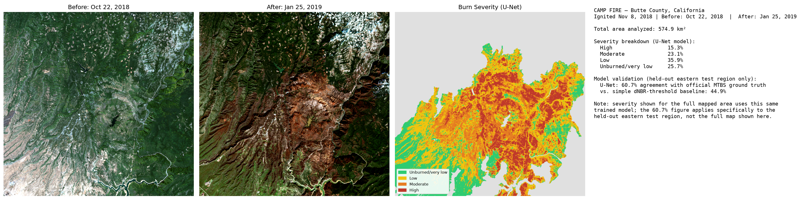

# Wildfire BurnScan — Wildfire Burn Scar Tracker

NASA gives you the exact location and date of a wildfire. Grab a satellite photo from just before the fire and one from just after, and a model can highlight exactly which areas burned and how severely — "spot the difference" for fire damage, done automatically, using data real fire-monitoring agencies actually use.

This project builds that pipeline end to end for the **2018 Camp Fire** (Butte County, California — the deadliest and most destructive wildfire in California history) and validates every result against official government ground truth, not just eyeballed guesses.

## The result



**574.9 km² analyzed. 15.3% high severity, 23.1% moderate, 35.9% low, 25.7% unburned.** Validated against official MTBS ground truth on a held-out region: **60.7% agreement**, vs. 44.9% for a naive threshold-only baseline.

## How it works, in plain words

Satellite images aren't just red/green/blue — they capture infrared light too, which is where fire damage actually shows up most clearly. Healthy vegetation reflects near-infrared light strongly; burned vegetation doesn't. **NBR** (Normalized Burn Ratio) turns that into a single number per pixel, and **dNBR** (the before/after difference in NBR) is the standard change-detection signal fire agencies use.

Two models were built and compared:
1. **Baseline** — threshold the raw dNBR value into severity bands (unburned/low/moderate/high), using thresholds pulled directly from MTBS's own calibration for this specific fire, not generic textbook numbers.
2. **U-Net (primary model)** — a small convolutional neural network trained on 64×64 image patches, using all 12 raw spectral bands (6 before + 6 after) as input, so it can use spatial context a per-pixel threshold rule structurally cannot.

## Validation — and a specific, diagnosed weakness

The baseline's errors weren't random — a spatial disagreement map showed a solid, concentrated overestimation bias at the fire's core (likely the town of Paradise and the most totally destroyed forest around it), because a threshold rule treats every pixel identically regardless of its surroundings. The U-Net was built specifically to target that weakness, and a second spatial comparison confirmed it worked: the overestimation blob measurably broke up, not just moved elsewhere.

| Metric | Baseline | U-Net |
|---|---|---|
| Overall agreement (held-out test region) | 44.9% | **60.7%** |
| Moderate-severity precision | 32.8% | 60.9% |
| High-severity precision | 25.6% | 51.2% |

One hypothesis (a missing MTBS calibration offset) was tested as a possible explanation for the baseline's bias and explicitly ruled out — see `learning.md` for the full trail of what was tried, what worked, and what didn't.

## Repository structure

```
scripts/          22 numbered scripts, run in order, tell the full pipeline story
data/raw/          FIRMS detections, Sentinel-2 bands, MTBS ground truth (not tracked in git -- regenerate by running scripts/01-09)
data/processed/    Aligned rasters, NBR/dNBR, severity maps, trained model, all visualizations
environment.yml    Conda environment (see Setup below)
handoff.md         Current project state (for resuming work)
decisions.md       Every technical decision made, with reasoning and alternatives considered
learning.md        Every blocker hit, root cause, and fix (including a ruled-out hypothesis)
1.md               Interview prep notes, session by session, plus a final end-to-end Q&A block
```

### Script index

**Core pipeline** (run in order to reproduce the result from scratch):
`01_firms_pull` → `02_sentinel2_search` → `03_check_tile_coverage` → `04_january_search` → `05_export_scenes` → `08_mtbs_ground_truth_check` → `09_export_mtbs` → `10_align_rasters` → `12_compute_nbr` → `13_dnbr_threshold` → `14_compare_baseline_to_mtbs` → `17_choose_split` → `20_build_train_unet` → `22_phase4_output`

**Diagnostics / exploration** (not required to reproduce the final output, but document the actual debugging and validation process): `06_debug_after_scene`, `07_verify_before_scene`, `11_plot_before_after`, `15_plot_disagreement`, `16_test_offset_correction`, `18_plot_split_and_patches`, `19_verify_patch_class_counts`, `21_unet_vs_baseline_spatial`

## Setup

```
conda env create -f environment.yml
conda activate burnscan
```

You'll also need a free [NASA FIRMS API key](https://firms.modaps.eosdis.nasa.gov/api/map_key/) and a [Google Earth Engine](https://earthengine.google.com/) account (free, non-commercial tier). Put your credentials in `scripts/.env`:
```
FIRMS_API_KEY=your_key_here
GEE_PROJECT_ID=your_gee_project_id
```

## Tech stack

Python, Google Earth Engine (`earthengine-api`, `geemap`), `rasterio` + `geopandas` for geospatial processing, `numpy` for band math, PyTorch (CPU) for the U-Net, `matplotlib` for visualization.

## Data sources

- [NASA FIRMS](https://firms.modaps.eosdis.nasa.gov/) — fire detection points (location, date, confidence)
- [Copernicus Sentinel-2](https://sentinel.esa.int/web/sentinel/missions/sentinel-2) (ESA), accessed via Google Earth Engine — before/after satellite imagery
- [MTBS](https://www.mtbs.gov/) (Monitoring Trends in Burn Severity, USGS/USFS) — official ground-truth burn severity data
